# Dataset Card：GoEmotions（TID-8）

課堂版定案資料集。2026-10-19 實測比較四個候選後選定，研究決策與使用方式見 [研究規格](./00-research-spec.mdx)。

:badge[已定案]{variant="success"} 定案日期 2026-10-19。

## 1. 基本資訊

| 項目 | 內容 |
| --- | --- |
| 使用版本 | [`MichiganNLP/TID-8`](https://huggingface.co/datasets/MichiganNLP/TID-8) 的 `goemotions-atr` config |
| 原始出處 | Demszky et al. 2020,《GoEmotions: A Dataset of Fine-Grained Emotions》（[ACL 2020](https://aclanthology.org/2020.acl-main.372/)） |
| 原始資料位置 | [google-research-datasets/go_emotions](https://huggingface.co/datasets/google-research-datasets/go_emotions)（`raw` config 保留 `rater_id`） |
| 授權 | **Apache-2.0**（追到原始出處確認） |
| 取得方式 | 直接下載，無須申請 |
| 內容 | Reddit 留言的情緒標註 |
| 語言 | 英文 |
| 標籤集合 | positive、negative、ambiguous、neutral（4 類單標籤） |
| TID-8 論文 | Beck et al. 2023（[Findings of EMNLP 2023](https://aclanthology.org/2023.findings-emnlp.832/)） |

### 1.1 標籤分組的由來

原始 GoEmotions 是 27 類多標籤。TID-8 收錄的版本依 Demszky 等人的做法（論文附錄 B.3）壓成 4 類單標籤。**這個分組是 TID-8 做的，不是本專題自行合併**，引用時須寫明。

### 1.2 授權追溯

TID-8 的 Dataset Card 授權欄標示 `unknown`，其論文也沒有授權聲明，只有 Ethics Statement 說明八個子資料集都是既有的公開資料。因此授權一律追到原始出處；追完才看得出候選之間差距很大（見第 5 節）。

## 2. 使用子集的定義

**只取恰好 3 份標註的 item。**

整個 `goemotions` config 有 57,703 個 item、193,633 筆標註，但每題標註數從 1 到 5 不等。只取恰好 3 份的子集，是為了讓分母固定——這樣就沒有「標註數本身洩漏答案」的問題，entropy 的分母也一致。

`goemotions-ann` 與 `goemotions-atr` 兩個 config 資料量相同（都是 193,633 筆），差別只在切法（`-atr` 的 25 位 test annotator 與 train 完全不重疊）。因為本專題自己重切，取哪一個都可以；為與下列統計一致，固定取 `-atr`。

> 這點與 md-agreement 不同——那個資料集的 `-ann` 版砍掉了約 12% 的標註。

## 3. 實測統計

> 以 TID-8 在 Hugging Face 上的 parquet 檔為來源，train 與 test 合併計算（本專題要自己重切）。腳本為 `scripts/run_eda.py`，資料與產物不進 repo。
>
> **本節有兩組數字。** 3.1–3.3 是 2026-10-19 的原始統計，**在文字去重之前**算的（31,766 個 item）；3.4 是 2026-10-31 以 `scripts/run_eda.py` 重跑的結果，**去重之後**（31,603 個 item），也就是實驗管線實際使用的數字。兩組差異全部來自那 163 筆重複文字，量級都在 0.1 到 0.6 個百分點之間。引用時以 3.4 為準。

| 項目 | 數值 |
| --- | --- |
| item 數（恰好 3 份標註） | **31,766** |
| annotation 數 | 95,298 |
| annotator 數 | 79 |
| 每位 annotator 的題數 | 最少 8、Q1 83、中位數 822、平均 1,206、Q3 2,224、最多 5,782 |
| 每題標註數 | 固定 3 份 |
| 類別分布（標註層級） | positive 39.6%、neutral 32.2%、negative 18.8%、ambiguous 9.3% |
| 有任何分歧的 item（`z_i=1`） | **49.7%** |
| 三人三種標籤 | 1.3% |
| 二分圖連通分量 | 1 個，涵蓋 100% |
| 文字長度（字元） | Q1 34、中位數 60、Q3 91、P95 130、最長 703 |
| 重複文字 | 163 筆（31,766 個 item 對應 31,603 段不同文字） |
| 其他可用欄位 | `subreddit`（483 個）、`author`、原始 27 個情緒欄位 |

### 3.1 分歧的型態

| 三人的標籤組合 | item 數 | 佔比 |
| --- | ---: | ---: |
| positive（全一致） | 8,691 | 27.4% |
| neutral＋positive | 5,756 | 18.1% |
| negative＋neutral | 4,199 | 13.2% |
| neutral（全一致） | 3,320 | 10.5% |
| negative（全一致） | 2,981 | 9.4% |
| ambiguous＋neutral | 2,613 | 8.2% |
| negative＋positive | 1,322 | 4.2% |
| ambiguous（全一致） | 1,002 | 3.2% |

分歧集中在語意相鄰的類別——neutral 與 positive、neutral 與 negative、ambiguous 與 neutral——而真正相反的 negative 與 positive 只佔 4.2%。這是錯誤分析的現成材料：模型抓不到的應該多半是相鄰類別的邊界題，而不是極性顛倒。

### 3.2 揭露 2 份之後的難度

真正要預測的是「可見的 2 份標註一致，但第三位會偏離」這個子集——可見已經不一致的題目必然分歧，規則不用學就全對，沒有研究價值。5 個 seed 的實測：

| seed | 可見一致的 item | 其中第三位偏離 |
| ---: | ---: | ---: |
| 0 | 21,165（66.6%） | 5,171（24.4%） |
| 1 | 21,083（66.4%） | 5,089（24.1%） |
| 2 | 21,157（66.6%） | 5,163（24.4%） |
| 3 | 21,195（66.7%） | 5,201（24.5%） |
| 4 | 21,169（66.6%） | 5,175（24.4%） |

難題子集的陽性率 **24.4%**，是四個候選裡最適合排序任務的：預算 10% 而地雷佔 24%，排得好不好差別明顯。對照其他候選的同一個數字——md-agreement 59.0%、sentiment 82.2%、CommitmentBank 93.6%——越接近 100% 就越是「不管怎麼排都會撞到」，`Recall@10%` 讀不出模型能力。

### 3.4 去重後重跑（2026-10-31，管線實際使用）

以 `uv run python scripts/run_eda.py` 產生，與 3.1–3.3 的差異只來自文字去重。

| 項目 | 去重前（2026-10-19） | 去重後（2026-10-31） |
| --- | ---: | ---: |
| item 數 | 31,766 | **31,603** |
| annotation 數 | 95,298 | **94,809** |
| annotator 數 | 79 | 79 |
| 有任何分歧的 item | 49.7% | **49.8%** |
| 三人三種標籤 | 1.3% | 1.3% |
| 每位 annotator 題數（中位數／平均） | 822／1,206 | **818／1,200** |
| 文字長度 Q1／中位數／Q3／P95 | 34／60／91／130 | 34／60／**92**／130 |
| 類別分布 positive／neutral／negative／ambiguous | 39.6／32.2／18.8／9.3 | **39.5／32.3／18.9／9.3** |
| subreddit 數 | 483 | 483 |

揭露 2 份之後的難度（對照 3.2）：

| seed | 可見一致的 item | 其中第三位偏離 |
| ---: | ---: | ---: |
| 0 | 20,943（66.3%） | 5,083（24.3%） |
| 1 | 21,098（66.8%） | 5,238（24.8%） |
| 2 | 21,066（66.7%） | 5,206（24.7%） |
| 3 | 21,031（66.5%） | 5,171（24.6%） |
| 4 | 20,990（66.4%） | 5,130（24.4%） |

難題陽性率 24.3% 至 24.8%，與去重前的 24.1% 至 24.5% 同一量級，結論不變。

以下三項與去重無關，重跑結果與原始統計**完全一致**：

| 驗證項目 | 結果 |
| --- | --- |
| 每題標註數分布 | 1 份 1,877、2 份 6,103、**3 份 31,766**、4 份 5,533、**5 份 12,424** |
| 上游 split 重疊（見 4.1） | test 的 **96.0%** 也出現在 train |
| 前五大 subreddit 分歧率 | 42.1% 至 54.2% |

### 3.5 標註數洩漏答案的證據

對應研究規格 6.4 第 7 條。各標註數分組的分歧率：

| 每題標註數 | item 數 | 分歧率 |
| ---: | ---: | ---: |
| 1 | 1,877 | 0.0% |
| 2 | 6,103 | 30.7% |
| **3** | **31,766** | **49.7%** |
| 4 | 5,533 | 88.1% |
| 5 | 12,424 | 85.5% |

分歧率隨標註數陡升——4 份與 5 份都在 85% 以上。這不是巧合，而是「不清楚的例子被加標」造成的，所以標註數本身就是答案的代理變數。只取恰好 3 份的子集，分母固定，這條洩漏才被切斷。

## 4. 已知代價與處理方式

| 代價 | 處理方式 |
| --- | --- |
| 只有 79 位 annotator | 無法像 md-agreement（819 位）那樣研究「對沒見過的新 annotator 泛化」，論文的冷啟動實驗要降級為探索性結果。但每位標了平均 1,206 題，annotator 歷史特徵反而比 md-agreement 更充足 |
| 隱藏只剩 1 份標註 | target 的語意是「第三位會不會偏離前兩位」，比隱藏 3 份更噪；也算不出有意義的完整 entropy `H_i`（只有 3 個標籤），所以主要 target 固定用「任何分歧」，不使用 `H_i \ge \tau` 的門檻版本 |
| 4 類是 TID-8 的分組 | 原始是 27 標籤多標籤，引用時須寫明分組依據與來源（見 1.1） |
| 含 Reddit 使用者名稱 | `author` 欄位是個資，載入後立刻丟棄；`subreddit` 保留當穩健性軸（前五大 subreddit 的分歧率在 42.1% 到 54.2% 之間） |
| 標註數 1 到 5 份不等 | 只用恰好 3 份的子集。**不要把 5 份的 12,424 題混進來**——那是「不清楚的例子被加標」造成的，分歧率衝到 85.5%，標註數本身就洩漏答案 |
| 163 筆重複文字 | 切 split 前以文字去重、每段文字只保留第一個 item，去重後 31,603 個 item（Q5 已決議）。不採合併，因為合併會讓該 item 的標註數不等於 3，與固定分母的前提衝突 |

### 4.1 自帶 split 不能用

`goemotions-atr` 的 test item 有 **96.0%** 同時出現在 train（`sentiment-ann` 是 100%、`md-agreement-atr` 是 99.7%）。TID-8 的兩種切法都是為了研究「從分歧中學習」設計的，不是為本專題的排序任務設計的，對本題的 target 構成洩漏。**一律自己以 `item_id` 重切。**

## 5. 候選比較與排除理由

下面兩張表是同一件事的查找版：圖給形狀，表給細節。

### 5.1 授權與取得方式

| 項目 | GoEmotions（定案） | md-agreement | sentiment |
| --- | --- | --- | --- |
| 原始論文 | Demszky et al. 2020（[ACL 2020](https://aclanthology.org/2020.acl-main.372/)） | Leonardelli et al. 2021,《Agreeing to Disagree》（[EMNLP 2021](https://aclanthology.org/2021.emnlp-main.822/)） | Díaz et al. 2018（CHI 2018；[IJCAI 轉載](https://www.ijcai.org/proceedings/2019/852)） |
| 原始資料位置 | [google-research-datasets/go_emotions](https://huggingface.co/datasets/google-research-datasets/go_emotions) | [dhfbk/annotators-agreement-dataset](https://github.com/dhfbk/annotators-agreement-dataset/) | [Harvard Dataverse DOI:10.7910/DVN/F6EMTS](https://dataverse.harvard.edu/dataset.xhtml?persistentId=doi:10.7910/DVN/F6EMTS) |
| 取得方式 | 直接下載 | 不可直接下載，須填表單向作者申請 | 直接下載 |
| 授權 | **Apache-2.0** | 無開源授權；限非商業研究、不得用於側寫或針對個人、受 Twitter 開發者政策約束 | CC0 1.0（公眾領域） |
| 內容 | Reddit 留言情緒，4 類單標籤 | 英文推文攻擊性言論，三領域（BLM、Elections2020、Covid-19） | Sentiment140 推子集，不同年齡層標註者重標 5 級情緒 |

### 5.2 排除理由

| 候選 | 排除原因 |
| --- | --- |
| md-agreement | **授權**：上游限非商業研究且要填表單，TID-8 轉散佈版標 `unknown`，這條鍊在論文公開階段站不住。數字本身是合格的（6,592 item、819 annotator、單一連通分量、難題陽性率 59.0%），**保留為論文階段的第二資料集候選**——跨資料集穩健性那一章用得上，屆時照流程申請原始檔 |
| sentiment | **目標退化**：93.7% 的 item 有分歧，難題子集陽性率 82.2%，壓成三類仍有 87.3%。而且每位標註者固定標 40 題，圖被切成 305 個互不相連的批次、最大一塊只涵蓋 1.9% 的 item，annotator 歷史與 GraphSAGE 都不成立。TID-8 論文自己的結果也印證這點：annotator split 下 SNT 的 annotation embedding 效能大幅衰退 |
| CommitmentBank | 只有 1,200 個 item（剛好卡在門檻）、7 類序數標籤讓分歧率高到 97.9%（壓成三類才降到 79.4%）、文本是 326 字元的長段落，授權也查不到明確聲明 |

### 5.3 定案經過

同一天（2026-10-19）先依實測數字選過 md-agreement，後來因為授權問題改定 GoEmotions。實測之後還發現它的目標分布比 md-agreement 更平衡，所以這個改動不是退讓。

> 調研階段曾把 GoEmotions 的優先度評為「低」，理由是「多標籤且類別多，超出期末專案範圍」。該判斷已被實測推翻：TID-8 收錄的版本已壓成 4 類單標籤，理由不成立。

## 6. 合格門檻對照

研究規格的資料合格門檻與本資料集的對照：

| 門檻 | 要求 | GoEmotions | 判定 |
| --- | --- | --- | --- |
| 可用 item 數 | ≥ 1,000 | 31,766 | :badge[通過]{variant="success"} |
| 每 item annotation 數 | ≥ 3 | 固定 3 | :badge[通過]{variant="success"} |
| 分歧 item 比例 | ≥ 10% | 49.7% | :badge[通過]{variant="success"} |
| 多數 annotator 不只標一筆 | — | 中位數 822 題 | :badge[通過]{variant="success"} |
| 穩定 item／annotator ID 與 label | — | 具備 | :badge[通過]{variant="success"} |
| 授權允許課程研究與論文引用 | — | Apache-2.0 | :badge[通過]{variant="success"} |

## 7. 資料治理

- 資料檔不進版控（`data/` 已在 `.gitignore`）。本文件只記錄彙總統計，不含任何原始文字或個別 annotation。
- `author` 欄位載入後立刻丟棄。
- 送外部 Embedding API 無授權障礙（Apache-2.0），但必須先丟掉 `author`。此限制與繁中 pilot 不同——繁中 pilot 一律只用本機 `bge-m3`。
