# 期末簡報內容

:badge[草稿]{variant="warning"} 內容待確認，尚未製作投影片。

| 項目 | 內容 |
| --- | --- |
| 題目 | 部分標註下的標註分歧預測與複核排序 |
| 機器學習任務 | **分類** |
| 資料集來源 | GoEmotions（Google Research，Apache-2.0） |
| 時間 | 12 分鐘 ＋ Q&A 3 分鐘 |
| 發表日期 | 2026-12-14 或 2026-12-21，依學號排定（Q8 未公布，按最壞情況準備） |

**本文件是衍生品。** 所有數字來自 [研究規格](./00-research-spec.mdx) 第 8 章與 [Dataset Card](./10-dataset-card-goemotions.mdx)；那邊改了，這邊要跟著改。不要在這裡訂新的研究決策。

## 0. 講者備忘

**全場主線（一句話）**：想用機器學習幫忙排複核順序，結果發現一張四列的查表就夠了。

| 段落 | 分鐘 | 這一段要讓聽眾記住什麼 |
| --- | ---: | --- |
| 1 問題描述 | 2.0 | 這是排序問題，不是分類準確率問題 |
| 2 數據收集 | 1.5 | 多數資料集不保留個別標註，所以能用的很少 |
| 3 資料分析與前處理 | 2.0 | 「標註數」本身會洩漏答案 |
| 4 模型訓練 | 2.0 | 對照組選錯會誇大模型的功勞 |
| 5 模型評估 | 3.0 | **全場重點**：指標飽和、查表逼近、配對比較 |
| 6 結論 | 1.5 | 建議不要上模型 |

### 視覺化

文件內嵌六個互動元件（`.notecraft/components/`），用 `npm run docs` 開 port 4326 可以操作。它們的順序對應講稿節奏：

| 元件 | 位置 | 要解決的理解障礙 |
| --- | --- | --- |
| `annotation-reveal-setup` | 1 問題描述 | 「只看兩份、猜第三份」用講的要 30 秒，而且聽眾會建立錯誤的心智模型 |
| `annotation-count-leakage` | 3 資料前處理 | 標註數洩漏答案，數字擺在一起才有戲劇性 |
| `metric-saturation` | 5 模型評估 | 「確定會吵的 1,588 題 > 名額 474」純講很難懂；拖動預算就看得到 |
| `review-routing-flow` | 5 模型評估 | 為什麼難題組才是正確的評估範圍。也可在 Q&A 重新叫出來 |
| `baseline-results` | 5 模型評估 | 主結果與配對證據。配對分頁把每個 seed 畫成兩段，一看就看出「哪一段比較陡」 |
| `neutral-only-flagging` | 5 模型評估 | 兩個模型都只送 neutral 組；差別在組內精確率 |

### 投影片用的靜態圖

七張，依講稿順序排列。原始檔在 `diagrams/`，用 `diagram-design` skill 產生；改圖與重新匯出的指令見 [`diagrams/README.md`](../diagrams/README.md)。

**第 1 段 · 問題描述**

**第 3 段 · 資料前處理**

**第 5 段 · 指標為什麼飽和**

**第 5 段 · 為什麼難題組才是正確範圍**

**第 5 段 · 主結果**

**第 5 段 · 配對證據**

**第 5 段 · 錯誤分析的機制**

這七張對應上表的六個互動元件（`baseline-results` 拆成主結果與配對證據兩張）。**簡報放這些靜態圖，文件保留互動版**供你操作。

**上台用的那份要輸出成靜態圖。** 投影時沒人會去點，而且互動元件會卡。這六個是給你檢視與調整用的；製作投影片時各截一張圖，每張只保留一個訊息、字放大、顏色只分「重點／其他」兩層。

刻意沒有做的：四個候選資料集比較（表格就夠）、洩漏檢查七條（不會講到）、混淆矩陣（2×2 做成熱圖沒有比表格清楚）、錯誤分析的文字訊號表（四類 × 七個訊號，做成圖更亂）。模型階梯建議做成版面角落的小進度條當全場骨架，不要獨立一頁。

### 已定案的講法（2026-10-31）

| 事項 | 決定 |
| --- | --- |
| **評估範圍（Q11）** | 兩個範圍並列、**以難題組為主**。先用整體範圍說明指標為什麼飽和，再切到難題組呈現真正的差異 |
| **第 5 段編排** | 保留三個轉折，**壓縮飽和段**——只講一句話加一張可拖動預算的圖，不展開細節 |
| **階梯 1.5 的講法** | **照實講**是做完實驗後補的，並說明為何不是事後挑選：entropy 在難題組恆為 0 是數學事實，而且補的是**更強**的對照，讓比較更保守而非更寬鬆 |
| **零樣本 LLM 對照線（Q9）** | **不做**。被問到時用 Q&A 第 3 題回答——資料污染使分數不可檢驗，這個回答本身就展示了理解 |
| **Label Suite 動機頁** | 不加，省下 30 秒 |

第 5 段的分鐘分配：

| 內容 | 分鐘 |
| --- | ---: |
| 主要指標是什麼 | 0:20 |
| 「指標壞掉了」一句話 ＋ 拖動預算圖 | 0:30 |
| 改看難題組 ＋ 分流圖 | 0:40 |
| 結果表（含查表） | 0:50 |
| 配對比較斜線圖 | 0:30 |
| 錯誤分析：只送 neutral | 0:30 |

## 1. 問題描述（2 分鐘）

### 開場：一個每天都在發生的狀況

做 AI 要先有標註好的資料。實務上同一題會發給好幾個人標，因為一個人會看錯、會有主觀偏好。

一則 Reddit 留言發給 3 個人，標它的情緒是**正面、負面、模糊、中立**哪一種：

- 三個人都說「正面」→ 沒事，這題確定了
- 兩個人說「中立」、一個人說「正面」→ **這種才需要人進去看**，是標註規則沒寫清楚，還是這題本身就有爭議

### 問題在哪

要等三個人**全部標完**，才知道哪些題會吵。但標註是陸續進來的，能複核的人力又有限。

所以要做的是**提早預警**：只看**前兩個人**的答案加上留言本身的文字，先算出「這題最後會吵起來的機率」，照機率由高到低排序，複核的人從最上面開始看。

### 這是什麼任務

**二元分類。**

| 元素 | 內容 |
| --- | --- |
| 一筆資料 | 一則 Reddit 留言 |
| 特徵 | 留言文字 ＋ 前 2 個人的標註 |
| 要預測的答案 | 三個人標完之後有沒有出現分歧（有 = 1、沒有 = 0） |
| 輸出怎麼用 | 模型輸出的機率拿來**排序**，當複核的優先順序 |

> **要強調**：最後看的不是「分類準不準」，而是「排序好不好」。實務上的問題是「今天只有時間看 10% 的題目，幫我排」，不是「這題到底會不會吵」。

### 為什麼不是「看前兩個人有沒有吵」就好

這是最直覺的做法，也是對照組之一。但它只抓得到**已經明顯**的那種。

真正有價值的是另一種：**前兩個人剛好意見一致，但其實是爭議題**。這種用規則看會被判成安全，直接漏掉。

實際數字：隨機抽兩個人的答案來看，**66.5% 的題目前兩人是一致的**，而這些題裡有 **24.4%** 第三個人給了不同答案。只看前兩人一不一致，這四分之一的爭議題全部會漏掉。

**這批「看起來沒事、其實有事」的題目，就是整個專案要解的對象。**

{/* @ai-visualize
id: annotation-reveal-setup
type: motion
prompt: |
  用互動方式說明本專案的問題設定：一則留言發給 3 位標註者，模型只看得到其中 2 份，第 3 份藏起來只用來算答案。提供兩個案例可切換——「前兩人一致但第三人不同」與「前兩人就已不一致」，並有一個按鈕可以揭露第三份標註，讓讀者親身體驗「看起來沒事、其實有事」這件事。
caption: 切換案例、按下揭露，體驗模型看得到什麼、看不到什麼
status: generated
*/}

import GeneratedFrame from '@/components/GeneratedFrame.astro'
import AnnotationRevealSetup from '@notes/components/annotation-reveal-setup'

<GeneratedFrame id="annotation-reveal-setup" type="motion" prompt={"用互動方式說明本專案的問題設定：一則留言發給 3 位標註者，模型只看得到其中 2 份，第 3 份藏起來只用來算答案。提供兩個案例可切換——「前兩人一致但第三人不同」與「前兩人就已不一致」，並有一個按鈕可以揭露第三份標註，讓讀者親身體驗「看起來沒事、其實有事」這件事。"} caption="切換案例、按下揭露，體驗模型看得到什麼、看不到什麼">
  <AnnotationRevealSetup client:idle />
</GeneratedFrame>

## 2. 數據收集（1.5 分鐘）

### 關鍵限制：多數公開資料集不能用

絕大多數標註資料集只給**投票之後的最終答案**，例如「這題是正面」。那樣就無法研究分歧怎麼形成——看不到三個人原本各標了什麼。

所以需要的是**保留每一位標註者個別答案**的資料集。

### 用了哪一個

**TID-8 裡的 GoEmotions 子資料集**（`goemotions-atr`）。

| 項目 | 內容 |
| --- | --- |
| 原始出處 | Demszky et al. 2020, GoEmotions（ACL 2020），Google Research |
| 取得 | Hugging Face 直接下載 |
| 授權 | **Apache-2.0** |
| 內容 | Reddit 留言的情緒標註，4 類：positive / negative / ambiguous / neutral |
| 關鍵特性 | **完整保留「哪一位標註者標了哪一題、標了什麼」** |

### 比較過四個候選才選它

原本先選了另一個資料集（md-agreement），後來改掉，理由是**授權**：

- 它的上游沒有開源授權、限非商業研究、要填表單向作者申請
- TID-8 的轉散佈版授權欄寫 `unknown`

→ **授權不能只看 Hugging Face 的標示，要一路追到原始論文。** 追完才發現四個候選差很多。

另外兩個被排除：

- **sentiment**：93.7% 的題目都有分歧，目標退化——不管怎麼排都會撞到爭議題，看不出模型好壞
- **CommitmentBank**：只有 1,200 題，太小

GoEmotions 除了授權乾淨，目標分布也最平衡，所以這個改動不是退讓。

## 3. 資料分析與前處理（2 分鐘）

### 資料長什麼樣

| 項目 | 數值 |
| --- | ---: |
| 原始 | 57,703 題、193,633 筆標註 |
| **篩出每題恰好 3 人標的** | **31,766 題** |
| 文字去重後 | 31,603 題、94,809 筆標註 |
| 標註者人數 | 79 人（每人平均標 1,200 題） |
| **有任何分歧的題目** | **49.8%** |
| 文字長度 | 中位數 60 個字元（很短） |

標籤分布：positive 39.5%、neutral 32.3%、negative 18.9%、ambiguous 9.3%。

### 四個前處理決定，每個都有原因

#### ① 只取「恰好 3 個人標」的題目

原始資料每題標註數從 1 到 5 不等。只取 3 份的，理由是這張表：

| 每題標註數 | 題數 | 分歧率 |
| ---: | ---: | ---: |
| 1 | 1,877 | 0.0% |
| 2 | 6,103 | 30.7% |
| **3** | **31,766** | **49.7%** |
| 4 | 5,533 | **88.1%** |
| 5 | 12,424 | **85.5%** |

4 份和 5 份的分歧率衝到 85% 以上。這不是巧合——**當初就是因為這題不清楚才被加派人手去標**。所以「標註數」這個欄位本身就洩漏答案。固定成 3 份，這條路徑才被切斷。

> 這一頁值得多講 10 秒，它展示的是發現資料陷阱的能力。

{/* @ai-visualize
id: annotation-count-leakage
type: chart
prompt: |
  長條圖呈現「每題標註數」與「分歧率」的關係：1 份 0.0%、2 份 30.7%、3 份 49.7%、4 份 88.1%、5 份 85.5%。把本專案保留的「3 份」標示為重點色，其餘灰階，凸顯標註數本身就洩漏答案。
caption: 4 份與 5 份的分歧率衝到 85% 以上——標註數本身就是答案的代理變數
status: generated
*/}

import AnnotationCountLeakage from '@notes/components/annotation-count-leakage'

<GeneratedFrame id="annotation-count-leakage" type="chart" prompt={"長條圖呈現「每題標註數」與「分歧率」的關係：1 份 0.0%、2 份 30.7%、3 份 49.7%、4 份 88.1%、5 份 85.5%。把本專案保留的「3 份」標示為重點色，其餘灰階，凸顯標註數本身就洩漏答案。"} caption="4 份與 5 份的分歧率衝到 85% 以上——標註數本身就是答案的代理變數">
  <AnnotationCountLeakage client:idle />
</GeneratedFrame>

#### ② 丟掉 `author` 欄位

是 Reddit 使用者名稱，屬於個資，載入後立刻刪除。

#### ③ 資料集自帶的 train/test 不能用

實際比對後發現它的 **test 題目有 96.0% 同時出現在 train**。原因是那個切法是為了研究別的問題設計的，不是為這個任務設計的。所以自己重切。

#### ④ 切分規則：同一題的三筆標註必須在同一邊

| split | 題數 | 佔比 | 分歧率 |
| --- | ---: | ---: | ---: |
| train | 22,122 | 70% | 49.81% |
| val | 4,740 | 15% | 49.81% |
| test | 4,741 | 15% | 49.82% |

另外先做了文字去重（163 筆重複），避免同一段文字同時出現在 train 和 test。

### 怎麼模擬「只看到前兩個人」

每一題隨機抽 2 份標註給模型看，第 3 份藏起來。藏起來的那份**只用來算答案，絕對不能進特徵**。

因為抽哪 2 份是隨機的，跑了 **5 組不同的隨機種子**，所有結果都報 5 組的平均 ± 標準差。

### 特徵

| 類型 | 內容 |
| --- | --- |
| 文字 | TF-IDF，1–2 gram，最多 5 萬維（實際用到 31,451 維） |
| 可見標註 | 前兩人是否一致、可見標籤的 entropy、票數差距、各標籤的票數 |

> TF-IDF **刻意沒有移除 stopwords**。文字中位數只有 60 個字元，而 not、maybe、but 這些詞本身就是「這句話有歧義」的訊號——移掉等於把要預測的東西丟掉。

## 4. 模型訓練（2 分鐘）

### 四層階梯，由笨到聰明

| 層 | 方法 | 用途 |
| --- | --- | --- |
| 0 | 隨機排序 | 地板線 |
| 1 | 可見標籤 entropy（前兩人一不一致） | 「不用機器學習」的對照 |
| 1.5 | **同意標籤查表** | **做完實驗後才補上的，見下方** |
| 2 | Logistic Regression | 第一個真正的 ML 模型 |
| 3 | Gradient Boosting | 檢查非線性有沒有額外好處 |

### 第 1.5 層是做完實驗後補的

原本只有 entropy 這一條規則當對照。但實驗跑完發現：**在「前兩人一致」的那批題目上，entropy 永遠等於 0**——兩個人標一樣，entropy 當然是 0。它在那批上完全沒有排序能力，等於亂猜。

拿一個「等於亂猜」的東西當對照組，會把機器學習的功勞誇大。

所以補了一條更公平的規則：**前兩人同意的是哪一個標籤**。這只是一張四列的查表，從訓練資料算出來：

| 前兩人同意 | 訓練集裡的分歧率 |
| --- | ---: |
| neutral | **43.8%** |
| ambiguous | 34.7% |
| negative | 22.0% |
| positive | 12.1% |

同意「中立」的題目，分歧率是同意「正面」的 3.6 倍。**不需要訓練、不需要處理文字，查表就好。**

### 超參數調整

| 項目 | 設定 |
| --- | --- |
| 方法 | `GridSearchCV` |
| 交叉驗證 | `GroupKFold`（5 折），**group 是題目 ID** |
| 評分標準 | 直接用主要指標 `Recall@10%` |
| LR 調 | `C`（0.01 / 0.1 / 1 / 10）、`class_weight` |
| GB 調 | `learning_rate`、`max_depth` |

**為什麼一定要 `GroupKFold` 而不是普通的 `KFold`？**

因為訓練資料把 5 組隨機種子**疊在一起**（同一題出現 5 次，每次給模型看的 2 份不同）。如果用普通 `KFold`，同一題的不同版本會同時落在訓練折和驗證折裡，分數會虛高。

訓練資料：73,596 筆、20,406 個不重複題目。

### 調參結果

| 模型 | 最佳參數 | 交叉驗證分數 | 耗時 |
| --- | --- | ---: | ---: |
| Logistic Regression | `C=0.003` | 19.42% | 13 秒 |
| Gradient Boosting | `lr=0.05`、`max_depth=3` | 20.36% | 111 秒 |
| BGE-M3 + LR | `PCA=64`、`C=0.003` | 20.07% | 395 秒 |

交叉驗證分數 19.42% 與後面測試集的 19.3% 幾乎一樣，沒有過擬合。

第三列是**選做項目**：同一個 Logistic Regression、同一批可見標註特徵，只把 TF-IDF 換成 `BAAI/bge-m3` 的 1024 維向量，再用 PCA 降到 64 維。PCA 維度由交叉驗證從 64／128／256 選出，而且 **PCA 一定要放在 Pipeline 裡**——主成分是由資料算出來的統計量，先對全部資料算一次再切折就是洩漏。

## 5. 模型評估（3 分鐘）

:badge[全場重點]{variant="danger"}

### 主要指標

**`Recall@10%`：只複核 10% 的題目時，能抓到多少比例的爭議題。**

選這個是因為它直接對應實務問句：「今天只有時間看 10%，幫我排。」

### 先講一個意外：指標一開始是壞掉的

原本在整個測試集上算 `Recall@10%`，結果所有方法都一樣。查下去發現：

- 測試集 4,741 題，其中 **1,588 題（33.5%）前兩人就已經不一致**
- 這 1,588 題**百分之百有分歧**——這是定義，不用學
- 而 10% 的預算只有 **474 個名額**

**確定會吵的題目有 1,588 題，名額只有 474 個。** 所以任何方法只要把這批排前面，準確率就是 100%，`Recall@10%` 固定卡在理論上限 20.1%。沒有任何模型贏得了，不是因為規則強，而是**指標撞到天花板**。

要讓整體指標有鑑別力，預算得超過 33.5%，遠高於實務會用的 10%。

{/* @ai-visualize
id: metric-saturation
type: motion
prompt: |
  用一條比例尺呈現測試集 4,741 題的組成：1,588 題（33.5%）可見已不一致、必然分歧，其餘 3,153 題可見一致、其中 24.7% 有分歧。加上一個可拖動的「複核預算」slider，即時顯示 K、Precision@K 與 Recall@K，讓讀者看到預算低於 33.5% 時 Precision 恆為 100%、指標完全無法區分模型。
caption: 拖動預算：超過 33.5% 之前，任何方法的 Precision 都是 100%
status: generated
*/}

import MetricSaturation from '@notes/components/metric-saturation'

<GeneratedFrame id="metric-saturation" type="motion" prompt={"用一條比例尺呈現測試集 4,741 題的組成：1,588 題（33.5%）可見已不一致、必然分歧，其餘 3,153 題可見一致、其中 24.7% 有分歧。加上一個可拖動的「複核預算」slider，即時顯示 K、Precision@K 與 Recall@K，讓讀者看到預算低於 33.5% 時 Precision 恆為 100%、指標完全無法區分模型。"} caption="拖動預算：超過 33.5% 之前，任何方法的 Precision 都是 100%">
  <MetricSaturation client:idle />
</GeneratedFrame>

### 所以改看「難題組」

**難題組 ＝ 前兩人意見一致的題目**（可見已不一致的不需要模型，直接送複核就好）。

{/* @ai-visualize
id: review-routing-flow
type: diagram
prompt: |
  逐步揭露的流程圖，說明實際部署時複核工作如何分流：標註進來（4,741 題）→ 判斷前兩人是否一致 → 否（1,588 題、33.5%）直接送複核、不需要模型 →是（3,153 題、66.5%）交給模型排序、取前 10%（315 題）→ 兩條路匯入人工複核佇列。用三個步驟分段點選，讓讀者理解為什麼「難題組」才是正確的評估範圍。
caption: 逐步點選：為什麼模型只需要處理「看起來一致」的那批
status: generated
*/}

import ReviewRoutingFlow from '@notes/components/review-routing-flow'

<GeneratedFrame id="review-routing-flow" type="diagram" prompt={"逐步揭露的流程圖，說明實際部署時複核工作如何分流：標註進來（4,741 題）→ 判斷前兩人是否一致 → 否（1,588 題、33.5%）直接送複核、不需要模型 →是（3,153 題、66.5%）交給模型排序、取前 10%（315 題）→ 兩條路匯入人工複核佇列。用三個步驟分段點選，讓讀者理解為什麼「難題組」才是正確的評估範圍。"} caption="逐步點選：為什麼模型只需要處理「看起來一致」的那批">
  <ReviewRoutingFlow client:idle />
</GeneratedFrame>

| 項目 | 整體測試集 | **難題組** |
| --- | ---: | ---: |
| 題數 | 4,741 | **3,153** |
| 分歧率 | 49.8% | **24.7%** |
| 10% 預算的名額 | 474 | 315 |
| `Recall@10%` 理論上限 | 20.1%（已達到） | **40.5%** |

這才是第 1 段講的那個問題：**看起來沒事、其實有事**的那批。

### 結果

| 模型 | PR-AUC | **`Recall@10%`** | 比隨機好幾倍 |
| --- | ---: | ---: | ---: |
| 隨機排序 | 24.5 | 9.5 ± 0.6 | 1.0× |
| 可見標籤 entropy | 24.7 | 9.9 ± 0.9 | 1.0× |
| **同意標籤查表** | 39.5 | **18.5 ± 0.8** | **1.9×** |
| Logistic Regression（TF-IDF） | 42.7 | **19.3 ± 0.7** | **1.9×** |
| Gradient Boosting（TF-IDF） | 44.6 | 19.4 ± 0.6 | 1.9× |
| **Logistic Regression（BGE-M3）** | 44.7 | **21.8 ± 0.5** | **2.2×** |

四個要講的點：

1. **entropy 規則完全無效**（9.9 對隨機的 9.5）。第 1 段的預測成立了——「看前兩人吵不吵」在這批題目上毫無用處。
2. **機器學習有效**：19.3% 對 9.5%，**翻倍**。只複核 10% 就能抓到兩成的爭議題。
3. **但那張四列查表拿到 18.5%**，是 TF-IDF 模型的 **96%**。
4. **換掉文字表示才真的拉開差距**：最後一列是同一個 Logistic Regression，只把 TF-IDF 換成 `bge-m3`，`Recall@10%` 從 19.3 升到 **21.8**。查表對它只佔 **85%**，不是 96%。

{/* @ai-visualize
id: baseline-results
type: chart
prompt: |
  兩個分頁。分頁一「排序成績」：六個方法的 Recall@10% 長條圖（隨機 9.5、可見 entropy 9.9、同意標籤查表 18.5、LR（TF-IDF）19.3、GB（TF-IDF）19.4、LR（BGE-M3）21.8），畫上隨機地板線與理論上限 40.5% 的參考線；四階語意色：灰＝地板線、金＝透明規則、淺藍＝TF-IDF 模型、深藍＝bge-m3 模型。分頁二「配對比較」：5 個 reveal seed 的三欄斜線圖，每個 seed 一條兩段折線，從「同意標籤查表」經「LR（TF-IDF）」連到「LR（BGE-M3）」；第一段細灰而平緩（配對差 +0.77 ± 0.38、5/5），第二段深藍而陡（+2.45 ± 0.72、5/5）。逐 seed 數值取自 artifacts/models/per_seed_r10_hard.csv。
caption: 切到「配對比較」看逐 seed 的真實差距：又小又穩
status: generated
*/}

import BaselineResults from '@notes/components/baseline-results'

<GeneratedFrame id="baseline-results" type="chart" prompt={"兩個分頁。分頁一「排序成績」：六個方法的 Recall@10% 長條圖（隨機 9.5、可見 entropy 9.9、同意標籤查表 18.5、LR（TF-IDF）19.3、GB（TF-IDF）19.4、LR（BGE-M3）21.8），畫上隨機地板線與理論上限 40.5% 的參考線；四階語意色：灰＝地板線、金＝透明規則、淺藍＝TF-IDF 模型、深藍＝bge-m3 模型。分頁二「配對比較」：5 個 reveal seed 的三欄斜線圖，每個 seed 一條兩段折線，第一段細灰而平緩、第二段深藍而陡。"} caption="切到「配對比較」看逐 seed 的真實差距：第一段小而穩，第二段大而穩">
  <BaselineResults client:idle />
</GeneratedFrame>

### 模型真的贏查表嗎？用配對比較

直接比「19.3 ± 0.7 對 18.5 ± 0.8」看起來差不多，因為標準差蓋過差距。但兩者跑在**完全相同的 5 組隨機種子**上，所以可以逐組相減：

| 模型 | 對查表的配對差 | 贏的組數 |
| --- | ---: | ---: |
| 隨機排序 | −9.05 ± 1.27 | 0/5 |
| entropy 規則 | −8.33 ± 0.86 | 0/5 |
| Logistic Regression（TF-IDF） | **+0.77 ± 0.38** | **5/5** |
| Gradient Boosting（TF-IDF） | +0.83 ± 0.55 | 5/5 |
| **Logistic Regression（BGE-M3）** | **+3.22 ± 0.86** | **5/5** |

**配對之後標準差從 0.7 掉到 0.38，而且 5 組全贏。** 所以文字模型的優勢是真的——TF-IDF 只有 0.77 個百分點，換成 `bge-m3` 之後是 3.22 個百分點。

### 換模型沒用，換文字表示才有用

再換一個參考點：以 TF-IDF 的 Logistic Regression 為基準，逐組相減。

| 改了什麼 | 配對差 | 贏的組數 |
| --- | ---: | ---: |
| 把 LR 換成 Gradient Boosting（換模型族） | +0.05 ± 0.27 | 2/5 |
| 把 TF-IDF 換成 BGE-M3（換文字表示） | **+2.45 ± 0.72** | **5/5** |

第一列的配對差比它自己的標準差還小，跟 0 分不出來。第二列的配對差是標準差的三倍以上，而且 5 組全贏。**這個任務上真正有效的槓桿是文字表示，不是分類器。**

> 這一頁要講清楚方法論：**只比平均 ± 標準差會誤判成「沒差」，只比對 entropy 的 9.5 個百分點會誤判成「大勝」。配對比較才看得到真相。**

### 混淆矩陣

門檻取自 **validation**（不是測試集），再套到測試集。這裡用結論採用的 **BGE-M3** 模型：

| 實際 ＼ 預測 | 預測安全 | 預測送複核 |
| --- | ---: | ---: |
| 實際一致 | 11,185 | 710 |
| 實際有分歧 | 3,105 | **791** |

精確率 52.7%、召回率 20.3%、特異度 94.0%、送出比例 9.5%。

送出比例 9.5% 代表 val 定出的門檻搬到 test 之後還是落在 10% 預算附近，沒有偏掉。

對照 TF-IDF：精確率 48.1%、送出比例 10.3%、召回率 20.2%。**抓到的一樣多，但 BGE 送出的更少**——同樣的預算下它命中更準。

### 錯誤分析（一）：模型學到的是語言的不確定性

| 訊號 | 抓對（TP） | 漏掉（FN） | 誤報（FP） | 正確放過（TN） |
| --- | ---: | ---: | ---: | ---: |
| 平均字元數 | 85 | 65 | 85 | 60 |
| 有否定詞 | 43.5% | 19.6% | **48.6%** | 14.3% |
| 有模糊詞 | 18.9% | 10.7% | 7.7% | 7.1% |
| 有條件或轉折詞 | 27.9% | 18.4% | 27.5% | 14.0% |

模型學到的是「**有否定詞、有模糊詞、有轉折、句子比較長 → 容易吵**」。很合理。

但它也在這些訊號上**過度觸發**——誤報（FP）的否定詞比例 48.6%，甚至比抓對的 43.5% 還高。漏掉的則是又短又沒有這些標記的留言，模型沒線索可用。

（這張是 BGE-M3 的。TF-IDF 的方向完全一樣，只是沒那麼極端：TP 37.4%、FP 39.6%。）

### 錯誤分析（二）：模型在操作點上其實只做一件事

| 前兩人同意 | 該組分歧率 | TF-IDF 送複核／精確率 | BGE-M3 送複核／精確率 |
| --- | ---: | ---: | ---: |
| neutral | 46.5% | **36.6%** ／ 48.2% | **33.6%** ／ **52.7%** |
| ambiguous | 29.3% | 0.0% ／ — | 0.0% ／ — |
| negative | 20.8% | 0.0% ／ — | 0.0% ／ — |
| positive | 12.3% | 0.0% ／ — | 0.0% ／ — |

**兩個模型送複核的題目都 100% 來自「兩人同意 neutral」這一組**，其他三組一題都沒送。所以這不是某個模型的毛病，是這個任務在 10% 預算下的結構。

**差別在組內。** TF-IDF 的精確率 48.2%，只比該組基礎分歧率 46.5% 高 1.7 個百分點——幾乎等於在組內隨機挑。BGE-M3 是 52.7%，高 **6.2 個百分點**。

→ 這就是整場的機制：**查表只能把 neutral 組排到前面，組內是隨機的。TF-IDF 幾乎沒超過這件事（所以只贏 0.77），BGE 才真的在組內排出了順序（贏 3.22）。**

{/* @ai-visualize
id: neutral-only-flagging
type: chart
prompt: |
  分組長條圖，依「前兩人同意的標籤」分成 neutral／ambiguous／negative／positive 四組，每組並列三根長條：該組真實分歧率（46.5／29.3／20.8／12.3）、TF-IDF 送複核比例（36.6／0／0／0）與 BGE-M3 送複核比例（33.6／0／0／0）。灰＝基礎分歧率、淺藍＝TF-IDF、深藍＝BGE-M3，與主結果圖同一套語意色。凸顯兩個模型送複核的題目都全部來自 neutral 組，其他三組掛零。
caption: 兩個模型在 10% 預算下都只送 neutral 組；差別在組內精確率——TF-IDF 48.2%（+1.7）、BGE-M3 52.7%（+6.2）
status: generated
*/}

import NeutralOnlyFlagging from '@notes/components/neutral-only-flagging'

<GeneratedFrame id="neutral-only-flagging" type="chart" prompt={"分組長條圖，依「前兩人同意的標籤」分成 neutral／ambiguous／negative／positive 四組，每組並列三根長條：該組真實分歧率、TF-IDF 送複核比例與 BGE-M3 送複核比例。灰＝基礎分歧率、淺藍＝TF-IDF、深藍＝BGE-M3。"} caption="兩個模型在 10% 預算下都只送 neutral 組；差別在組內精確率——TF-IDF 48.2%（+1.7）、BGE-M3 52.7%（+6.2）">
  <NeutralOnlyFlagging client:idle />
</GeneratedFrame>

## 6. 結論（1.5 分鐘）

### 回答原本的問題

> 只看前兩個人的答案，能不能預測這題會不會吵、而且勝過簡單規則？

**能，但要看跟誰比。**

- 對「前兩人吵不吵」這條直覺規則：**大勝，19.3% 對 9.9%，將近兩倍**
- 對「前兩人同意哪個標籤」這張四列查表：**TF-IDF 只贏 0.77 個百分點**，換成 `bge-m3` 的向量之後贏 **3.22 個百分點**（兩者都是 5/5 穩定贏）

### 給產品的建議：先上查表，要上模型就上 Embedding

這題有三個選項，代價差很多：

| 選項 | `Recall@10%` | 代價 |
| --- | ---: | --- |
| 四列查表 | 18.5 | 幾乎為零。不訓練、不處理文字、完全可解釋 |
| TF-IDF + LR | 19.3 | 維護 31,451 維詞彙表、訓練流程、模型版本管理 |
| BGE-M3 + LR | **21.8** | 再加 2.3 GB 模型權重、約 2 GB 的 torch 環境、每次重算 248 秒編碼，而且失去逐詞可讀的係數 |

**建議是先用查表**：它拿到最好模型的 85%，而且成本幾乎為零。**但如果要上模型，該上 Embedding 而不是 TF-IDF**——多花的 0.77 個百分點買不到什麼，多花的 3.22 個百分點才值得討論。

> 這個結論是一開始就預先設計好可以接受的走向之一——不是實驗失敗。重點不是「模型有沒有贏」，而是**贏多少、對誰贏、要付多少代價**。

### 一個自己打自己臉的發現

10/31 跑完 TF-IDF 的時候，結論是「一張四列查表拿到模型 95% 的效果，不要上模型」。11/09 換掉文字表示之後，同一張查表只佔 85%。

**那句「95%」沒有算錯，但它量的是 TF-IDF 的天花板，不是這個任務的天花板。** 說「簡單方法就夠了」之前，要先確認拿來比的那個「複雜方法」已經盡力了。

### 非線性模型沒有額外好處，換文字表示才有

Gradient Boosting 的 PR-AUC 比 Logistic Regression 高 1.9 個百分點，但主要指標**幾乎相同**（19.4 對 19.3，配對差 +0.05 ± 0.27、2/5），調參時間卻是 8 倍（111 秒對 13 秒）。

同樣的錢花在文字表示上就有效：配對差 +2.45 ± 0.72、5/5 全勝。**在這個任務上，升級輸入比升級模型划算。**

### 這個專案真正的收穫

| # | 陷阱 | 內容 |
| --- | --- | --- |
| 1 | 資料陷阱 | 「標註數」這個欄位本身會洩漏答案（4–5 份的分歧率 85% 以上） |
| 2 | 指標陷阱 | 原本的主要指標在整體測試集上是飽和的，換一個評估範圍才看得到差異 |
| 3 | 對照組陷阱 | 拿一個「等於亂猜」的規則當對照，會把模型的功勞誇大九倍 |
| 4 | 統計陷阱 | 只比平均 ± 標準差會漏掉真實的小差異，配對比較才看得出來 |
| 5 | 比較對象陷阱 | 說「簡單方法就夠了」之前，要先確認拿來比的複雜方法已經盡力——換掉文字表示就把差距從 0.77 拉到 3.22 個百分點 |

### 最後一句

> 機器學習不是沒用——它確實贏了，而且穩定地贏。但在這個任務的實際預算下，**一張能寫在便利貼上的查表就拿到了八成五的效果；而真正把差距拉開的不是更複雜的模型，是更好的文字表示。**

## 7. Q&A 準備

| 問題 | 回答 |
| --- | --- |
| 為什麼只用 10% 預算？20% 或 5% 會變嗎？ | 5% 和 20% 都算了，排名完全一樣。10% 是因為它對應實務上最常見的問句。 |
| 難題組只剩 3,153 題，樣本會不會太少？ | 5 組隨機種子的標準差都在 1 個百分點以內，配對比較 5/5 一致，結論穩定。嚴格做法是再做 bootstrap 信賴區間，留在後續。 |
| 為什麼不用 BERT 或大語言模型？ | 分兩件事。**Transformer 編碼器有做**：`BAAI/bge-m3`（XLM-RoBERTa 架構）就是最後那一列，`Recall@10%` 21.8。**零樣本大語言模型判斷沒做**，因為這題有特殊風險——GoEmotions 公開且被大量使用，LLM 預訓練時幾乎確定看過這些留言甚至標籤，分數**不可檢驗**。`bge-m3` 不同：它是無監督 Embedding，沒看過本專題的分歧標籤。 |
| BGE-M3 贏了，為什麼還建議先用查表？ | 因為差距是 3.2 個百分點，而代價是 2.3 GB 模型權重、約 2 GB 的執行環境、每次重算 248 秒編碼，還失去逐詞可讀的係數。查表拿到它的 85%、成本幾乎為零。這是成本效益問題，不是模型好壞問題。 |
| 為什麼 PCA 要放在 Pipeline 裡？ | 主成分是從資料的共變異數結構算出來的統計量。先對全部資料算一次 PCA 再切訓練／驗證折，測試集的結構就進到特徵裡了——分數會變好，而且不會報錯。放進 Pipeline 才能讓每一折只用訓練折 fit 它，有測試守著這件事。 |
| 10% 預算下不是根本輪不到難題組嗎？ | 對，這是重要前提。實際部署政策應該是：前兩人已不一致的自動送複核（不需模型），**剩下的複核能量才用在看起來一致的那批**。難題組的結果要在這個政策下才有意義。 |
| 中文資料可以用嗎？ | 這次只做英文。中文需要自己建小規模標註資料（找 3–5 位標註者），前置時間太長，排在這學期之後。 |
| 49.8% 的分歧率是不是太高？ | 這是情緒標註的特性——正面／中立／模糊的界線本來就主觀。而且分歧集中在語意相鄰的類別，真正極性相反（正面對負面）只佔 8.2%。 |
| 為什麼對照組是做完實驗才補的？ | entropy 在難題組恆為 0 是數學事實（兩人標一樣，entropy 必為 0），不是看了結果才挑的。補一條更強的對照是讓比較更保守，不是更寬鬆。 |
| 用到哪些課堂教的東西？ | 主幹都是課內的：邏輯迴歸（第 5 週）、正則化與 Pipeline（第 6 週）、交叉驗證、`GridSearchCV`、`class_weight` 與混淆矩陣（第 7 週）、TF-IDF 與 Gradient Boosting（第 12 週）、降維（第 13 週）。課外補的三項都是問題設定逼出來的，見 7.1。 |
| 課堂教的是 k-fold，為什麼改用 `GroupKFold`？ | 訓練集疊了 5 個 reveal seed，同一題會出現 5 次。一般 k-fold 會把同一題同時分到訓練折與驗證折，調參分數因此虛高——這正是第 7 週講的資料洩漏。`GroupKFold` 以題目為 group，保證同一題只在一邊。 |
| 課堂教的是 ROC-AUC，為什麼報 PR-AUC？ | 難題組的分歧盛行率只有 24.7%，ROC 的偽陽率分母是大量的負例，排序再差 FPR 也動得很慢，曲線看起來偏好。PR 曲線只看「抓出來的有多少是對的」，正例少時比較誠實。主要指標 `Recall@10%` 則直接對應「固定複核預算能抓多少」。 |
| 為什麼用 `TruncatedSVD` 不用課堂的 PCA？ | 兩者做的是同一件事（找變異最大的方向），差別在 PCA 要先置中。TF-IDF 是 3 萬多維的稀疏矩陣，一置中就變成密集矩陣、記憶體裝不下；`TruncatedSVD` 不置中，可以直接吃稀疏矩陣。 |

### 7.1 技術與課程對照

被問「這跟課程有什麼關係」時用。對照的是 notecraft 課程筆記第 1–15 週。

**課內直接用上**

| 技術 | 專題位置 | 課程週次 |
| --- | --- | --- |
| NumPy、Pandas | `data.py`、`reveal.py` | 第 3 週 |
| Logistic Regression（sigmoid、交叉熵） | 階梯 2 | 第 5 週 |
| L1／L2 正則化（調 `C`） | LR 調參 | 第 6 週 |
| `Pipeline` | TF-IDF → 分類器 | 第 6 週 |
| 先切分再處理（防資料洩漏） | TF-IDF 只在 train 上 fit；`tests/test_leakage.py` | 第 5、6、7 週 |
| k 折交叉驗證、`GridSearchCV` | `models.tune()` | 第 7 週 |
| `class_weight='balanced'` | 調參 grid | 第 7 週 |
| 自訂評分（`make_scorer`） | 以 `Recall@10%` 調參 | 第 7 週 |
| 混淆矩陣、precision／recall、門檻 | `metrics.confusion_at_threshold` | 第 7 週 |
| TF-IDF | `features.fit_tfidf` | 第 12 週 |
| Gradient Boosting | 階梯 3 | 第 12 週 |

**課內概念的延伸**

| 專題做法 | 課內對應 | 差異 |
| --- | --- | --- |
| `TruncatedSVD(200)` | PCA（第 13 週） | 不置中，能直接處理稀疏矩陣 |
| `HistGradientBoostingClassifier` | gradient boosting 原理（第 12 週） | sklearn 的直方圖加速實作 |
| item-level split | `train_test_split`（第 6 週） | 以題目為單位切，不是以列 |
| 可見標籤 entropy 當基準 | 熵（第 1、6 週） | 拿來當「不用 ML」的規則分數 |

**課外，問題設定逼出來的**

| 技術 | 為什麼需要 |
| --- | --- |
| `GroupKFold`（group = `item_id`） | 疊加 reveal seed 後，一般 k-fold 會洩漏 |
| PR-AUC | 正例少時比 ROC-AUC 敏感 |
| `Recall@K%`、`Precision@K%` | 任務是固定預算下的排序，不是分類 |
| 部分標註 reveal protocol | 本專題的問題設定 |
| 同分隨機打散、多 seed、配對比較 | 讓比較可重現、可檢驗 |

課內教了但沒用到的：神經網路與 CNN（第 10–11 週）、樸素貝氏（第 12 週）、LDA 與 t-SNE（第 13 週）、迴歸（第 14 週）、分群（第 15 週）。
