# 技術棧

> 以 repo 實況為準，**2026-11-09** 盤點。

本文件管**實際裝了什麼**；為什麼選它管在別處。

| 問題 | 看哪裡 |
| --- | --- |
| 裝了什麼、版本多少、指令怎麼下 | **本文件** |
| 為什麼選這個工具 | [研究規格 11](./00-research-spec.mdx) |
| 模型階梯、特徵、指標的定義 | [研究規格 7、8](./00-research-spec.mdx) |
| 資料集來源與授權 | [Dataset Card](./10-dataset-card-goemotions.mdx) |
| 做了沒 | [進度追蹤](./20-progress.mdx) |

## 1. Python 工具鏈

Python **3.13.0**（`pyproject.toml` 要求 `>=3.12`），套件管理 **uv 0.12.18**，版本鎖在 `uv.lock`。

| 套件 | 版本 | 用在哪 |
| --- | --- | --- |
| `numpy` | 2.5.4 | 全部 |
| `pandas` | 3.1.0 | 資料處理、manifest |
| `pyarrow` | 26.0.0 | 讀上游 parquet、寫 manifest |
| `scikit-learn` | 1.9.1 | 特徵、模型、調參、指標 |
| `scipy` | 1.18.1 | 稀疏矩陣串接 |
| `matplotlib` | 3.11.2 | EDA 直方圖 |
| `certifi` | 2026.10.23 | 下載憑證 |
| `pytest` | 9.2.0 | 測試（dev） |
| `ruff` | 0.17.3 | lint（dev） |
| `sentence-transformers` | 6.2.0 | `BAAI/bge-m3` 編碼（embed） |
| `torch` | 2.15.0 | 由 sentence-transformers 帶入，MPS 推論（embed） |
| `transformers` | 5.22.2 | 同上（embed） |
| `tokenizers` | 0.23.3 | 同上（embed） |
| `huggingface-hub` | 2.4.0 | 模型下載與 commit sha 解析（embed） |
| `safetensors` | 0.8.0 | 模型權重載入（embed） |

三個相依值得說明：

- **`certifi` 是被迫加的。** macOS 的 python.org 版 Python 不讀系統鑰匙串，`urllib` 預設下載會 `CERTIFICATE_VERIFY_FAILED`。`data.download_raw()` 明確指定 `ssl.create_default_context(cafile=certifi.where())`。
- **`embed` extra 刻意獨立。** `sentence-transformers` 會把 torch 一起帶進來（環境多約 2 GB，模型權重再約 2.3 GB），而它只服務研究規格 7.2 這個選做項目。放進主要 dependencies 會讓「只想重現課堂版主線」的人也得付這個代價，所以列為 optional extra；沒裝也能跑完 `run_models.py`，只會少掉 BGE 那一列。
- **`playwright` 沒有寫進 `pyproject.toml`**，所以 `uv sync` 會把它移除。只有 `diagrams/scripts/export_png.py` 用得到（會啟動 chromium）；要出 PNG 時再 `uv pip install playwright` 即可，不影響任何實驗，也不影響 HTML 與 SVG 出圖。

## 2. 技術架構

{/* @ai-visualize
id: tech-stack-architecture
type: diagram
prompt: |
  靜態技術架構圖（不互動）。主幹由上而下六層，每層一張卡片、層間用箭頭相連：
  1 執行環境（Python 3.13、uv 0.12.18，版本鎖在 uv.lock）；
  2 資料與運算（numpy、pandas、scipy、pyarrow）；
  3 建模（scikit-learn 1.9.1，列出實際用到的 Pipeline／GridSearchCV／GroupKFold／PCA／TruncatedSVD／ColumnTransformer）；
  4 專案套件 src/splitsense/（12 個模組，config 被 24 處 import、metrics 被 6 處）；
  5 可執行腳本 scripts/（6 支，標明執行順序）；
  6 產物 artifacts/（六個目錄，全部不進版控）。
  右側三塊旁支：選配的 extra 「embed」用虛線接回建模層（sentence-transformers → torch、Apple MPS、BAAI/bge-m3 1024 維，沒裝也能跑完主線）、
  品質閘（pytest 91 passed 2 skipped、ruff）、文件與視覺化鏈（Node 22、notecraftapp、recharts 做互動元件、diagram-design 做靜態 SVG）。
  四階語意色：本專案自己寫的用深藍、第三方套件用天藍、選配用金色虛線、其餘中性灰。
caption: 技術棧怎麼疊起來、誰依賴誰；資料怎麼流見下一節的管線圖
status: generated
*/}

import GeneratedFrame from '@/components/GeneratedFrame.astro'
import TechStackArchitecture from '@notes/components/tech-stack-architecture'

<GeneratedFrame id="tech-stack-architecture" type="diagram" prompt={"靜態技術架構圖（不互動）。主幹由上而下六層：執行環境、資料與運算、建模、專案套件 src/splitsense、可執行腳本 scripts、產物 artifacts。右側三塊旁支：選配的 extra 「embed」用虛線接回建模層、品質閘（pytest／ruff）、文件與視覺化鏈。四階語意色：本專案自己寫的用深藍、第三方套件用天藍、選配用金色虛線、其餘中性灰。"} caption="技術棧怎麼疊起來、誰依賴誰；資料怎麼流見下一節的管線圖">
  <TechStackArchitecture />
</GeneratedFrame>

這張回答「裝了什麼、誰依賴誰」，下一節的管線圖回答「跑哪支腳本會產出什麼」。兩張都存在是因為它們切的面不同：這張是**相依層級**，那張是**資料流**。

## 3. 管線總覽



要知道「跑哪支腳本會產出什麼」看這張就夠。箭頭上寫的四條不變量每條都有對應的測試（見第 7 節），相依關係由 `import` 反查而來，不是手寫的。

`config.py` 被 24 處 import、`metrics.py` 被 6 處——扇入太密，畫成連線會比方塊還多，所以用數字陳述而不是畫線。

## 4. 目錄佈局

| 目錄 | 內容 | 進版控 |
| --- | --- | --- |
| `src/splitsense/` | 套件本體，12 個模組 | 是 |
| `scripts/` | 6 支可執行腳本 | 是 |
| `tests/` | 8 個測試檔 ＋ `conftest.py` | 是 |
| `diagrams/` | 圖表原始檔（`.html`／`.svg`） | 是 |
| `docs/assets/` | 筆記引用的 SVG | 是 |
| `.notecraft/components/` | 互動元件 `.tsx` | 是 |
| `data/` | 上游 parquet | **否** |
| `artifacts/` | `eda/`、`manifests/`、`baselines/`、`models/`、`error_analysis/<model>/`、`embeddings/` | **否** |

所有實驗參數集中在 `src/splitsense/config.py`，不散落在各腳本——split 與 reveal 要能重現就靠這一點。

## 5. 常用指令

```text
uv sync --extra dev                             # 建環境（課堂版主線）
uv sync --extra dev --extra embed               # 另加 BGE-M3（torch 約 2 GB）
uv run python scripts/run_eda.py                # 重現 Dataset Card 第 3 節
uv run python scripts/build_dataset.py          # split 與 reveal manifest
uv run python scripts/run_baselines.py          # 階梯 0、1
uv run python scripts/embed_texts.py            # bge-m3 向量，寫快取（需 embed）
uv run python scripts/run_models.py             # 階梯 2、3 與 BGE，含調參
uv run python scripts/run_error_analysis.py     # 混淆矩陣與錯誤分析（TF-IDF）
uv run python scripts/run_error_analysis.py --model bge
uv run pytest                                   # 91 passed、2 skipped（裝 embed）
uv run ruff check src/ scripts/ tests/
```

從零（刪掉 `data/` 與 `artifacts/`）可完整跑通，所有 seed 固定。

`embed_texts.py` 可以單獨先跑，也可以不跑——`run_models.py` 找不到快取時會自己編碼，兩者都沒有（沒裝 `embed` extra）就跳過 BGE 那一列，主線照樣跑完。向量快取約 124 MB，存在 `artifacts/embeddings/` 並附一份 metadata JSON；讀取時比對模型名稱、commit sha、`normalize_embeddings`、`max_length`、維度與 item_id 順序，任一項不同就重算。

## 6. 程式盤點

3,463 行。

| 模組 | 負責 |
| --- | --- |
| `config.py` | 路徑與全域常數（split 比例與 seed、reveal 設定、預算、指標） |
| `data.py` | 下載、正規化 schema、丟棄 `author`、篩恰好 3 份、文字去重 |
| `eda.py` | Dataset Card 第 3 節的全部統計 |
| `split.py` | item-level 70/15/15，以 `z` 分層 |
| `reveal.py` | `r=2` 的 reveal manifest |
| `features.py` | TF-IDF ＋ 可見標註特徵 |
| `metrics.py` | 排序指標、門檻、混淆矩陣、配對比較 |
| `baselines.py` | 階梯 0、1、1.5，以及 full 範圍的部署式排序 |
| `models.py` | 階梯 2、3 與 BGE 階梯的 Pipeline、疊加 reveal seed 與調參 |
| `embeddings.py` | `bge-m3` 編碼、快取與 metadata 比對、向量與可見特徵串接 |
| `error_analysis.py` | 文字訊號、同意標籤剖面、邊界組合、抽樣（兩種文字表示各跑一次） |

### scikit-learn 實際用到的 API

```text
TfidfVectorizer · LogisticRegression · HistGradientBoostingClassifier
TruncatedSVD · PCA · StandardScaler · ColumnTransformer
Pipeline · GridSearchCV · GroupKFold
train_test_split · average_precision_score · make_scorer
```

`Recall@10%` 不是內建指標，是自寫函式包成 `make_scorer(response_method="predict_proba")`，讓 `GridSearchCV` 直接拿主要指標調參，而不是用 accuracy 之類的代理。

## 7. 測試盤點

裝了 `embed` extra 時 **91 passed、2 skipped**；沒裝時 90 passed、3 skipped。三個 skip 都是刻意的並標了原因：annotator 歷史與 GraphSAGE 的洩漏檢查（論文延伸實作時才啟用），以及唯一需要真實模型的那支（`pytest.importorskip`）。其餘 embedding 測試注入假的 encoder，不碰模型。

| 檔案 | 守什麼 |
| --- | --- |
| `test_leakage.py` | 研究規格 6.4 的洩漏七條、split 不變量、`author` 已丟棄、**PCA 只在訓練折上 fit** |
| `test_reproducibility.py` | 同 seed 重跑一致、比例與盛行率符合設定 |
| `test_metrics.py` | 指標手算對照、同分隨機打散、Recall 理論上限 |
| `test_features.py` | **改隱藏標註後特徵必須完全不變**、TF-IDF 只在 training 上 fit |
| `test_models.py` | `GroupKFold` 不讓同一 item 跨折、疊加 seed 後同 item 出現多次、兩個階梯選到同一批 row |
| `test_baselines.py` | entropy 在難題組恆為常數、低預算指標已飽和 |
| `test_error_analysis.py` | 混淆矩陣、比率在相加後才算、邊界組合用同一群體當基準 |
| `test_embeddings.py` | 快取 metadata 不一致就重算、向量列序與 `item_id` 對齊、串接欄序 |

## 8. 文件與視覺化

| 工具 | 版本 | 用途 |
| --- | --- | --- |
| Node | ≥ 22 | notecraftapp 的執行環境 |
| `notecraftapp` | ^1.13.0 | MDX 文件檢視，固定 port 4326 |
| `content-visualize` skill | — | 由 `@ai-visualize` 標記產生互動元件 |
| React | 18.3.1 | 互動元件本體，掛 `client:idle` |
| `recharts` | 2.15.4 | 三個圖表元件 |
| `lucide-react` | 0.469.0 | icon（skill 禁用 emoji） |
| `diagram-design` skill | v2.6.136 | 七張投影片用靜態圖，vendored 進 repo（MIT） |
| `trendlink-design` skill | — | 色票來源 |

### `@ai-visualize` 生成的元件（7 個）

| 元件 | 方式 | 互動 |
| --- | --- | --- |
| `annotation-count-leakage`、`baseline-results`、`neutral-only-flagging` | recharts | 有（分頁／hover） |
| `annotation-reveal-setup`、`metric-saturation`、`review-routing-flow` | 手寫 SVG | 有（拖動／逐步揭露） |
| `tech-stack-architecture` | 手寫 SVG | **無**，純靜態 |

純靜態的那個不掛 `client:*` directive——不需要 hydrate，SSR 出來就是最終畫面。

### 靜態圖的產生鏈

```text
diagrams/<name>.html          原始檔，改圖改這個
  → self_check.py             驗證無障礙 SVG 契約（標準庫）
  → export_svg.py             → diagrams/<name>.svg → docs/assets/（標準庫）
  → export_png.py             只在要放進簡報軟體時才跑（playwright + chromium）
```

筆記引用 **SVG**：七張合計 60 KB，換成 PNG 是 516 KB，而且 SVG 在任何解析度都銳利。

細節與色票規則見 [`diagrams/README.md`](../diagrams/README.md)。

> **notecraftapp 沒有 `remark-math` 與 `rehype-katex`。** `docs/` 的數學式一律用 fenced ` ```math ` 區塊，不要用 `$$`——`$$` 裡的大括號會被當成 JSX expression，行首的會讓 build 失敗，剛好是合法 JS 的會被靜默吞掉。

## 9. 流程與治理

| 項目 | 內容 |
| --- | --- |
| 版控 | Git，繁體中文 Conventional Commits |
| 規格 | 五層文件分工（研究決策／Dataset Card／進度／簡報／待釐清），每項決策只有一份真相 |
| OpenSpec | 課堂版期間暫停（Q6），`openspec/config.yaml` 已註明 |
| 資料治理 | `data/`、`artifacts/` 不進版控；`author` 載入後立刻丟棄；commit 前掃原始文字 |

## 10. 刻意沒有用的技術

| 技術 | 為什麼不用 |
| --- | --- |
| BERT、大語言模型 | GoEmotions 公開且被大量使用，LLM 預訓練幾乎確定看過這些留言甚至標籤，分數不可檢驗（Q9）。論文階段仍為必做 |
| PyTorch Geometric | GraphSAGE 屬論文延伸選做。torch 本身已隨 `embed` extra 進來，但只用於 `bge-m3` 推論，沒有自己訓練任何神經網路 |
| CUDA GPU | 本機沒有。`bge-m3` 的編碼走 Apple MPS（31,603 筆 248 秒），其餘全在 CPU 上跑完 |
| Random Forest | Q3 定案改用 `HistGradientBoostingClassifier`——TF-IDF 是 31,451 維稀疏矩陣，RF 的 `max_depth` 格線難調 |
